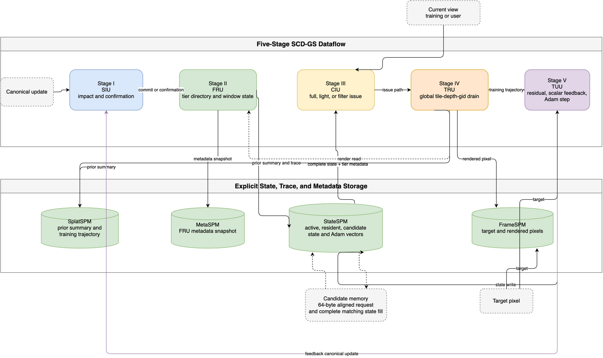

# SCD-GS Architecture

SCD-GS maintains one live Gaussian state across a five-stage loop. The state
properties that carry between stages are as important as the attribute values:
propagation type, residency tier, issue path, render trajectory, and structural
markers all remain attached to the same Gaussian identifier.

`StateSPM` stores shared Gaussian and Adam state. `MetaSPM` retains event and
allocator-final readback snapshots of FRU residency and short-window metadata; public
`metadataReadGid`, `metadataSnapshot`, and `metadataSnapshotValid` ports expose
them. `SplatSPM` stores prior training summaries and forward-render
trajectories. `FrameSPM` retains target and rendered-pixel records while TUU
receives the corresponding live target and trajectory streams. Because the
public renderer has no pixelwise coverage kernel, a TRU trajectory uses its
zero-extended tile ID as the representative-pixel key. FrameSPM is a bounded
256-entry direct-mapped, full-tagged record store: a key collision replaces the
old record and a read of the displaced key is invalid. This storage convention
does not change the live TUU pairing or imply a framebuffer implementation.

## Stage I: Splat Impact Unit

SIU receives a canonical update and the strictly earlier prior training-render
summary. It computes projected-center movement, the Frobenius norm of the
projected covariance change, opacity change, and view-dependent color change,
combines them into impact `psi`, and keeps a five-observation average `Phi`. A
structural update always becomes a state-changing commit. After warm-up, a
non-structural update becomes a state-changing commit only when `Phi >= tauPhi`.
Otherwise SIU emits a zero-strength confirmation.

## Stage II: Fused Residency Unit

FRU receives SIU propagation events and TRU training-render read events. Each
direct-indexed tier-directory entry stores a valid tag, residency tier, row, a 4-bit saturating
hotness counter `h`, and an 8-bit maximum effective-update field `d`. Active
and resident rows are partition-local physical rows. Candidate row metadata is
the `gid`-addressed logical location used by the refill path. FRU also forms
`E`, the mean observed effective strength in the current window. At each
five-frame boundary it allocates active, resident, and candidate regions, using
`h` first, `d` second, and ascending `gid` as the deterministic final tie
break. Untouched entries age by right shift and all `d`, energy, and sample
fields are cleared for the next window.

## Stage III: Conditioned Issue Unit

CIU pairs a complete residency response with a current view for the same
`(gid, frame)`, then projects the covariance with that view's `JCov` matrix and
derives the bounded support proxy `Omega`, a low-order color estimate `b(v)`,
rendering potential `P`, low-update confidence `kappa`, precision factor `rho`,
and effective workload `omega`. Structural or insufficient-history state uses
full work. Otherwise the unit chooses full, light, or filter according to
`tauRho` and `tauD`. Filtering is legal only for user requests. An equivalent
training request is routed to light.

## Stage IV: Tiered Render Unit

TRU accepts active, resident, and candidate work during a frame. At `frameEnd`,
it selects records in global `(tile, depth, gid)` order before compositing, so
residency tier cannot change blend order. Tiles whose transmittance falls below
`0.05` skip later records. The public renderer uses the bounded support proxy
as coverage rather than a pixelwise coverage kernel. The CIU-to-TRU handoff
preserves full, light, and user-filter tags, but a user filter is accepted and
bypasses the frame buffer and rendering backend. Training work emits a forward
trajectory with its current view to SplatSPM, where it becomes the next prior
summary. Its tile-derived representative-pixel record is written to FrameSPM,
and its trace emits a training-render read to FRU.

TRU accepts only the three public issue paths. An undefined path encoding is
discarded before it can enter the frame batch, alter transmittance, or emit a
render-side event. Training work at terminal frame `65535` is discarded at the
same boundary, because it cannot produce a next-frame feedback update. User
work remains valid at that frame because it has no feedback edge. A non-finite
depth is also discarded before queueing, so global compositing order remains
numerically defined.

## Stage V: Training Update Unit

TUU holds one target and consumes a matching TRU trajectory. It forms a scalar
surrogate gradient from RGB residual, coverage, and transmittance, applies the
documented Adam update shape, completes the StateSPM write, and then emits the
next canonical update. A mismatched trajectory is rejected without consuming
the target; the same rule rejects a user-view record or an invalid trajectory
path. TUU also defensively rejects a terminal 16-bit trajectory, so feedback
cannot wrap from frame `65535` to zero even through its direct input. The
feedback transaction does not require an external model package.

See the paper mechanism map and traceability matrix for implementation and test
links.
